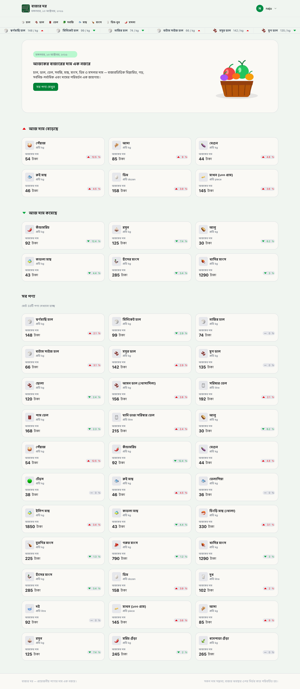
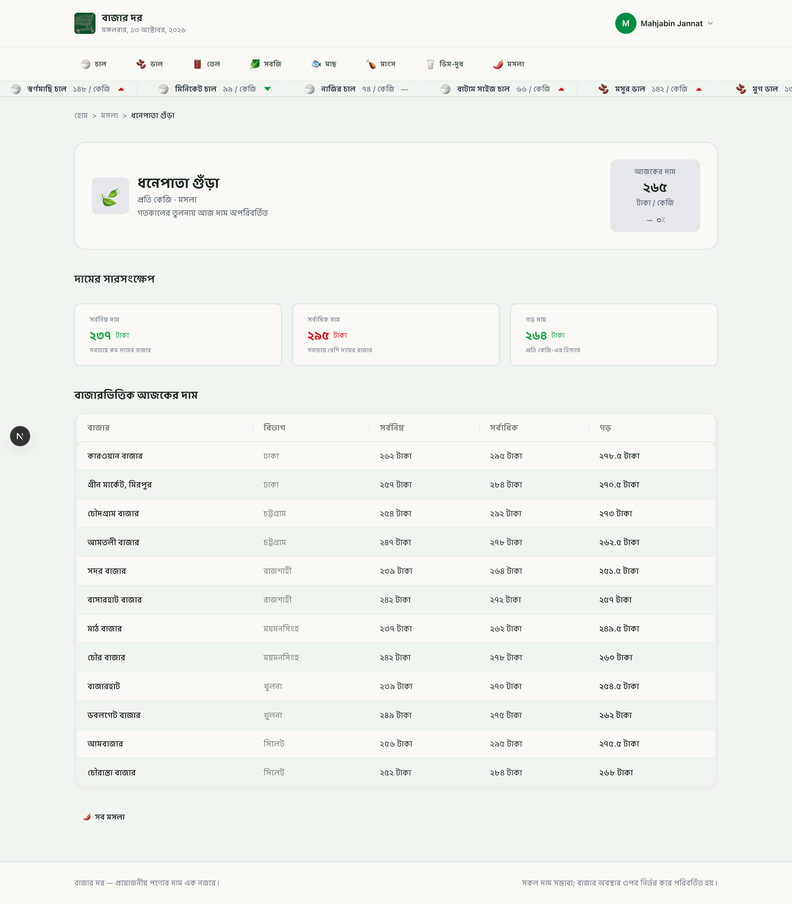
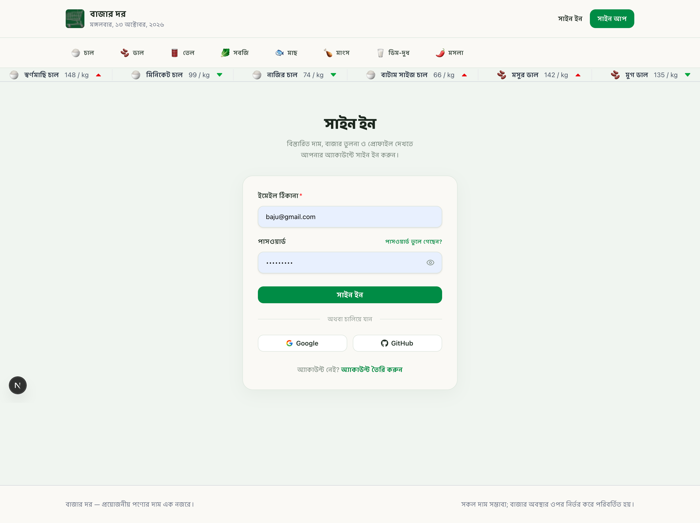
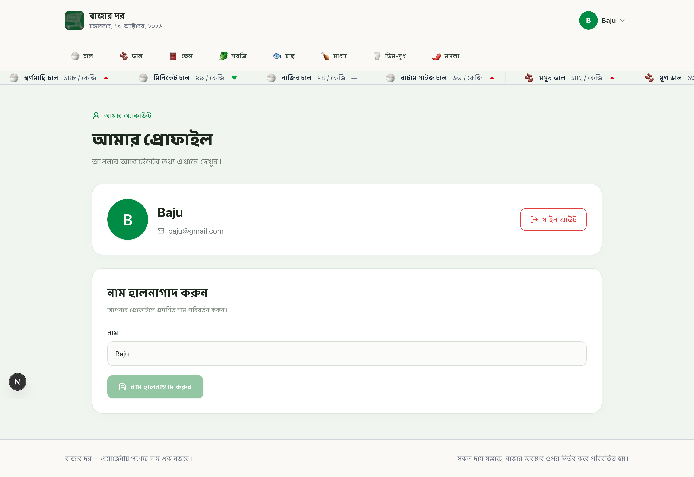

<div align="center">

# 🛒 বাজার দর | Bazar Dor

### 🇧🇩 Your Everyday Guide to Market Prices in Bangladesh

**A modern, responsive web application for exploring daily essential commodity prices, tracking price changes, and comparing prices across markets in Bangladesh.**

<br />


<br />

[🌐 Live Website](https://bazar-dor-six-pi.vercel.app/) • [💻 Source Code](https://github.com/Mahjabinjannat/bazard-dor)

</div>

---

## 📖 About the Project

**Bazar Dor (বাজার দর)** is a Bengali-language market price information platform designed to make everyday grocery price information easier to access and understand.

The application allows users to browse essential commodities, check their latest prices, monitor price increases or decreases, and compare prices across different markets and divisions in Bangladesh.

With a clean user interface, Bengali number formatting, category-based browsing, and secure authentication, Bazar Dor aims to provide a simple and accessible experience for everyday users.

---

## ✨ Key Features

### 🛍️ Market Price Information

- 📊 **Daily Commodity Prices** — View the latest available prices of essential products.
- 🗂️ **Category-Based Browsing** — Explore products by categories such as rice, lentils, oil, vegetables, fish, meat, dairy, and spices.
- 🔍 **Detailed Product Information** — View individual product prices and market information.
- 📈 **Price Change Indicators** — Identify price increases and decreases using color-coded indicators.
- 📅 **Historical Price Comparison** — Compare today's prices with yesterday's, last week's, and last month's prices.
- 🏪 **Market-Based Price Comparison** — Explore minimum, maximum, and average prices across different markets.
- ↕️ **Product Sorting** — Sort products by price in ascending or descending order.

### 🇧🇩 Bengali-Friendly Experience

- Bengali-language interface.
- Bengali number and currency formatting.
- Bengali date display.
- Local market and division information.
- Responsive layouts for mobile, tablet, and desktop devices.

### 🔐 Authentication & User Management

- Email and password authentication using Better Auth.
- Google and GitHub social sign-in.
- Session-based authentication.
- Dynamic navigation based on authentication status.
- User profile page.
- Update profile name.
- Secure sign-out functionality.

---

## 🖼️ Screenshots

Add screenshots of your application to a `screenshots` folder inside the `public` directory.

### 🏠 Homepage



### 🛒 Product Details



### 🔐 Authentication



### 👤 User Profile



---

## 🛠️ Technology Stack

| Technology         | Purpose                                    |
| ------------------ | ------------------------------------------ |
| **Next.js 16**     | Full-stack React framework and App Router  |
| **React 19**       | Component-based user interface             |
| **TypeScript**     | Static typing and improved maintainability |
| **Tailwind CSS 4** | Responsive styling                         |
| **HeroUI**         | Reusable UI components                     |
| **Better Auth**    | Authentication and session management      |
| **MongoDB**        | Authentication-related database storage    |
| **React Icons**    | Google, GitHub, and other icons            |
| **Lucide React**   | Interface icons                            |
| **REST API**       | Fetching market and product information    |

---

## 🌐 API Integration

Bazar Dor uses a REST API to retrieve product categories, prices, and market information.

**Base URL:**

```text
https://openapi.programming-hero.com/api/bazardor
```

### Available Endpoints

| Endpoint                 | Description                                |
| ------------------------ | ------------------------------------------ |
| `/categories`            | Retrieve product categories                |
| `/products`              | Retrieve all products                      |
| `/products?category=tel` | Retrieve products from a specific category |
| `/products/10`           | Retrieve details of a single product       |

### Example Product Data

```json
{
  "id": 10,
  "slug": "pam-tel",
  "nameBn": "পাম তেল",
  "category": "tel",
  "unit": "kg",
  "today": 168,
  "yesterday": 172,
  "lastWeek": 175,
  "lastMonth": 178,
  "change": {
    "dir": "down",
    "pct": -2.3
  }
}
```

The application formats the retrieved information into a user-friendly Bengali interface.

---

## 📂 Project Structure

```text
bazar-dor/
│
├── .next/
├── .vercel/
├── node_modules/
│
├── public/
│   └── screenshots/
│
├── src/
│   ├── app/
│   │   ├── (auth)/
│   │   │   ├── signIn/
│   │   │   │   └── page.tsx
│   │   │   ├── signUp/
│   │   │   │   └── page.tsx
│   │   │   └── profile/
│   │   │       └── page.tsx
│   │   │
│   │   ├── category/
│   │   │   └── [categoryId]/
│   │   │       ├── page.tsx
│   │   │       └── loading.tsx
│   │   │
│   │   ├── product/
│   │   │   └── [productId]/
│   │   │       ├── page.tsx
│   │   │       └── loading.tsx
│   │   │
│   │   ├── api/
│   │   │   └── auth/
│   │   │       └── [...all]/
│   │   │           └── route.ts
│   │   │
│   │   ├── page.tsx
│   │   ├── layout.tsx
│   │   ├── globals.css
│   │   ├── loading.tsx
│   │   └── not-found.tsx
│   │
│   ├── components/
│   │   ├── shared/
│   │   │   ├── Footer.tsx
│   │   │   ├── Marquee.tsx
│   │   │   ├── ProductCard.tsx
│   │   │   ├── EmptyState.tsx
│   │   │   ├── Categories.tsx
│   │   │   ├── BanglaDate.tsx
│   │   │   ├── Navbar.tsx
│   │   │   └── NavbarAuth.tsx
│   │   │
│   │   ├── homePage/
│   │   │   ├── AllProducts.tsx
│   │   │   ├── Banner.tsx
│   │   │   ├── PriceUpdate.tsx
│   │   │   ├── PriceIncreased.tsx
│   │   │   └── PriceDecreased.tsx
│   │   │
│   │   ├── categorizedProducts/
│   │   │   ├── CategoryProductList.tsx
│   │   │   └── Dropdown.tsx
│   │   │
│   │   ├── productSummaryPage/
│   │   │   ├── ProductSummary.tsx
│   │   │   └── MarketBasedPrice.tsx
│   │   │
│   │   └── auth/
│   │       └── AuthSuccessToast.tsx
│   │
│   ├── lib/
│   │   ├── auth.ts
│   │   ├── api.ts
│   │   ├── auth-client.ts
│   │   ├── categories.ts
│   │   ├── categorizedProduct.ts
│   │   ├── products.ts
│   │   ├── productDetails.ts
│   │   └── formatBangla.ts
│   │
│   ├── types/
│   │   ├── market.ts
│   │   ├── category.ts
│   │   └── product.ts
│   │
│   └── proxy.ts
│
├── .env
├── .gitignore
├── AGENTS.md
├── eslint.config.mjs
├── next-env.d.ts
├── next.config.ts
├── package.json
├── package-lock.json
├── tsconfig.json
└── README.md
```

---

## 🚀 Installation and Setup

Follow these steps to run the project locally.

### 1. Clone the Repository

```bash
git clone YOUR_GITHUB_REPOSITORY_URL
```

### 2. Navigate to the Project Directory

```bash
cd bazar-dor
```

### 3. Install Dependencies

```bash
npm install
```

### 4. Configure Environment Variables

Create a `.env.local` file in the project root.

```env
BETTER_AUTH_SECRET=your_better_auth_secret
BETTER_AUTH_URL=http://localhost:3000

BETTER_AUTH_DB_URL=your_mongodb_connection_string

GOOGLE_CLIENT_ID=your_google_client_id
GOOGLE_CLIENT_SECRET=your_google_client_secret

GITHUB_CLIENT_ID=your_github_client_id
GITHUB_CLIENT_SECRET=your_github_client_secret
```

Make sure the variable names match those used in your authentication configuration.

**Security:** Never commit `.env.local` or actual credentials to GitHub.

### 5. Start the Development Server

```bash
npm run dev
```

### 6. Open the Application

Visit:

```text
http://localhost:3000
```

---

## 🧠 What I Learned

Building Bazar Dor helped me practice and improve my understanding of:

- Next.js App Router and dynamic routing.
- React Server Components and Client Components.
- TypeScript interfaces and type-safe API integration.
- Data fetching and caching in Next.js.
- Reusable React component architecture.
- Responsive UI design with Tailwind CSS.
- HeroUI component customization.
- Authentication using Better Auth.
- Session management and conditional rendering.
- Google and GitHub OAuth integration.
- MongoDB integration for authentication.
- Form validation and error handling.
- Bengali localization and number formatting.
- Sorting, filtering, and processing API data.
- Managing loading states and asynchronous operations.

---

## 🔮 Future Improvements

Some possible enhancements for the project include:

- 🔎 Product search functionality.
- ⭐ Save favorite products.
- 📉 Interactive historical price charts.
- 📍 Location-based market filtering.
- 🔔 Price change notifications.
- 🌙 Dark mode support.
- 🌐 Bengali and English language switching.
- 📱 Progressive Web App (PWA) support.

---

## 👩‍💻 Author

**Mahjabin Jannat**

🎓 Computer Science & Engineering Graduate  
💻 Aspiring Frontend Developer  
🌱 Learning modern web development with React, Next.js, and TypeScript

### 🔗 Connect With Me

- **GitHub:** [Mahjabin Jannat](https://github.com/Mahjabinjannat)
- **Project Repository:** [Bazar Dor](YOUR_GITHUB_REPOSITORY_URL)
- **Live Website:** [Visit Bazar Dor](YOUR_LIVE_WEBSITE_URL)

---

<div align="center">

### 💚 Made with care for everyday shoppers in Bangladesh

**বাজার দর — নিত্যপ্রয়োজনীয় পণ্যের দাম জানুন সহজেই।**

⭐ If you find this project useful, consider giving it a star!

</div>
